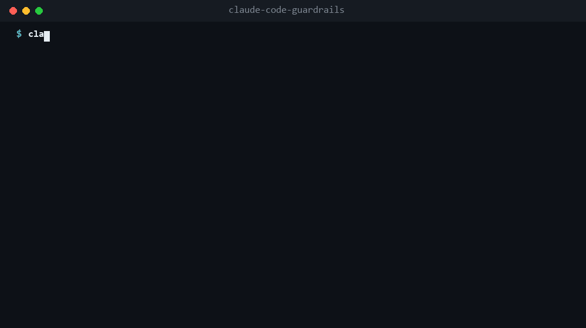
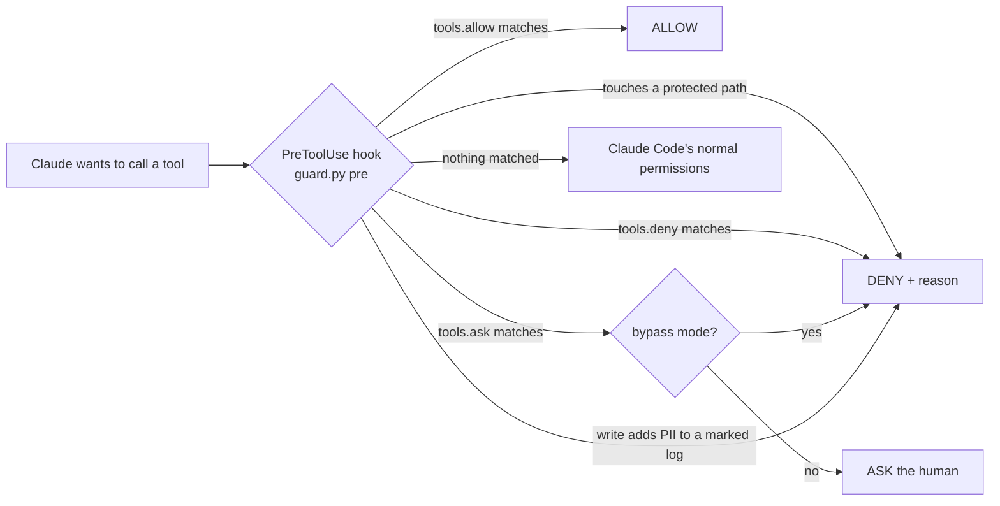

# claude-code-guardrails

[](https://github.com/TGabeCar/claude-code-guardrails/actions/workflows/ci.yml)
[](LICENSE)


**Put your AI agent on a leash.** Config-driven safety hooks for [Claude Code](https://docs.claude.com/en/docs/claude-code): keep it out of your secrets, stop it from sending, paying or destroying things on its own, and keep personal data out of committed logs. One Python file, one JSON config, zero dependencies.

<p align="center"></p>

Born from running Claude Code as a daily operations agent (scheduled jobs, live APIs, real money), where "please be careful" in a system prompt is not a control.

## 30-second install

```bash
pip install git+https://github.com/TGabeCar/claude-code-guardrails
cd your-project
claude-guardrails init --preset solo      # or team / production
claude-guardrails doctor                  # verify, then restart Claude Code
```

`init` copies one self-contained hook script into `.claude/hooks/`, writes `.claude/guardrails.json` from a preset, and merges the hook wiring into `.claude/settings.json` without touching anything else there. Run it twice and nothing duplicates. After that, the package itself is optional: the hook needs only Python.

## What it stops

| Guard | Hook | What happens |
|---|---|---|
| **Protected paths** | `PreToolUse` | Any Read, Grep, Glob, Write, Edit, shell command or MCP call that touches a listed path or glob (`.env`, `~/.ssh/`, `*.pem` …) is **denied**. Home-expanded and Windows paths are covered too. |
| **Tool rules** | `PreToolUse` | `deny` / `allow` / `ask` by tool-name glob (`mcp__*__send_*`), narrowed by input regex (`"when": {"command": "terraform\\s+destroy"}`). |
| **Read-only shell pass** | `PreToolUse` | `unless_read_only_shell` lets `git log`, `grep` and `cat` through a remote-command tool, and still asks for anything that could write. |
| **Bypass-mode safety** | `PreToolUse` | In `bypassPermissions` mode (unattended runs) nobody can answer an `ask`, so it becomes a **deny**. |
| **PII-in-logs guard** | `PreToolUse` | Blocks writes that *add* personal email addresses to files you mark (`logs/*.md`). Allowed domains are configurable. |
| **Session start check** | `SessionStart` | Tells Claude when it started in the wrong folder, how many tracked files changed outside a commit, and how many rules loaded. |
| **Instruction audit log** | `InstructionsLoaded` | One line per loaded `CLAUDE.md` or rule file, so you can prove what the agent was told. |

Every decision carries a reason Claude can read and act on. The hook fails open on its own bugs, so it never bricks your session.

## Presets

| Preset | For | Highlights |
|---|---|---|
| `solo` | Your own machine | Secrets locked, no sending or posting as you, asks before `rm -rf` / force-push |
| `team` | Shared repos | + PII guard on logs, asks before any `git push`, rule-load check and audit log |
| `production` | Agents with live access | + money movement denied, `terraform apply` / `kubectl delete` denied, every live write asks, reads flow freely |

`claude-guardrails presets` lists them; the JSON lives in [`guardrails/presets/`](guardrails/presets).

## Test a rule before Claude hits it

```text
$ claude-guardrails explain Bash '{"command": "terraform destroy"}'
   DENY  Infra and schema changes go through your pipeline, not the agent.
  rule: tools.deny

$ claude-guardrails explain mcp__crm__execute_api '{"endpoint": "GET /v1/deals"}'
   ALLOW  Read-only API lookup.
  rule: tools.allow

$ claude-guardrails explain mcp__crm__delete_contact --bypass
   DENY  Blocked in bypass mode (nobody can approve): Deletes live records.
  rule: bypass_ask_becomes_deny
```

## How it works



The order is protected paths → `deny` → `allow` → `ask` → PII. The first match wins, so a narrow `allow` (GET only) can sit above a broad `ask`.

## Config reference

```jsonc
{
  "protected_paths": ["~/.ssh/", ".env", "*.pem"],    // path-boundary match, or a glob if it has * ? [
  "tools": {
    "deny":  [{ "match": "mcp__*__send_*", "reason": "Humans send email." }],
    "allow": [{ "match": "mcp__*__execute_api", "when": { "endpoint": "^GET " } }],
    "ask":   [{ "match": "mcp__*__run_command", "unless_read_only_shell": true }]
  },
  "bypass_ask_becomes_deny": true,
  "pii": { "paths": ["logs/*.md"], "allowed_email_domains": ["yourcompany.com"] },
  "session_start": { "expected_cwd": null, "warn_uncommitted": true, "rules_dir": ".claude/rules" },
  "instructions_log": { "dir": ".claude/logs" }
}
```

- **`when`:** every field regex must match the tool input for the rule to apply.
- **Config lookup:** `$GUARDRAILS_CONFIG`, else `<project>/.claude/guardrails.json`, else safe built-in defaults.
- **Manual install:** prefer copying files? Copy [`guardrails/guard.py`](guardrails/guard.py) and [`examples/settings.json`](examples/settings.json) yourself.

## Honest limits

Hooks are a seatbelt, not a sandbox. A determined script can build a protected path at runtime (`"~/.s" + "sh"`) and slip past string checks. Pair this with OS-level permissions, and keep real secrets out of reach of the user account the agent runs as. Found a bypass? See [SECURITY.md](SECURITY.md).

## Development

```bash
python -m pip install -e ".[dev]"
python -m pytest -q
python scripts/make_media.py   # re-render docs/demo.gif and docs/social-preview.png (needs Pillow)
```

CI runs the suite on Linux and Windows across Python 3.10–3.13, plus a gitleaks secret scan. Contributions welcome: see [CONTRIBUTING.md](CONTRIBUTING.md) and the [good first issues](https://github.com/TGabeCar/claude-code-guardrails/labels/good%20first%20issue).

## License

MIT
